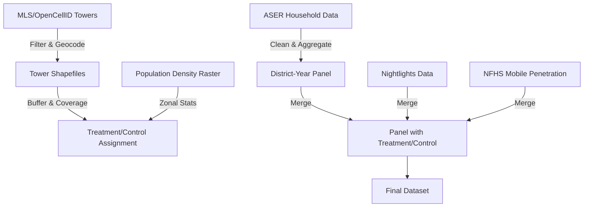

# Jio4G_Education_Paper

## Project Overview
This project investigates the impact of the Jio 4G rollout on educational outcomes in India, using district-level panel data and a difference-in-differences approach. The analysis combines multiple data sources to construct a comprehensive dataset for empirical analysis.

---

## Data Sources

1. **ASER Household Survey (2008–2018)**
   - Annual survey of rural education outcomes at the household level.
   - Provides reading and math achievement scores, household characteristics, and mobile ownership.
   - Source: [ASER Centre](https://www.asercentre.org/)

2. **Mobile Tower Data**
   - **Mozilla Location Service (MLS):** Crowdsourced cell tower locations, including operator and technology (LTE).
   - **OpenCellID:** Global cell tower database, used for cross-validation and additional coverage.
   - Source: [MLS](https://location.services.mozilla.com/), [OpenCellID](https://www.opencellid.org/)

3. **District Shapefiles**
   - Geospatial boundaries for Indian districts, used for spatial joins and zonal statistics.
   - Source: [Census of India](https://censusindia.gov.in/)

4. **Nightlights Data**
   - VIIRS annual mean nightlight intensity at the district level, proxy for economic activity.
   - Source: [Earth Observation Group](https://eogdata.mines.edu/)

5. **NFHS Mobile Penetration**
   - National Family Health Survey (NFHS-4) microdata, used to estimate district-level mobile phone penetration.
   - Source: [NFHS](http://rchiips.org/nfhs/)

6. **TRAI Data Prices and Usage**
   - Historical data on mobile data prices and usage in India.
   - Source: [TRAI](https://www.trai.gov.in/)

---

## Dataset Construction Process

### Step 1: Cleaning and Aggregating ASER Data
- Import ASER household data for 2010, 2012, 2014, 2016, and 2018.
- Clean and aggregate at the district-year level: reading/math scores, mobile ownership, household size, tuition, etc.

### Step 2: Mobile Tower Data Processing
- Clean and filter MLS and OpenCellID data for India, LTE towers only.
- Join with MCC-MNC codes to identify operator (Jio, Airtel, Vi).
- Create geospatial shapefiles for towers by operator and year.

### Step 3: Defining Treatment and Control Districts
- Use tower locations to define districts with high Jio 4G coverage (treatment) and low coverage (control).
- Create buffers around tower locations and calculate population under coverage using raster population density data.
- Assign treatment/control status based on coverage thresholds.

### Step 4: Merging Geospatial and Panel Data
- Join district-level ASER aggregates with treatment/control status and nightlights data.
- Merge with NFHS mobile penetration estimates.

### Step 5: Final Panel Construction
- Construct a district-year panel with all relevant variables for analysis.
- Export as CSV and shapefile for regression and mapping.

---

## Process Map

---

## Analysis Workflow
- **Regression Analysis:** Difference-in-differences estimation of Jio 4G impact on education outcomes.
- **Event Study:** Dynamic effects of 4G rollout over time.
- **Robustness Checks:** Alternative control groups, additional covariates.

---

## File Structure
- `ASER_cleaning.R`: ASER data cleaning and aggregation.
- `MLS_cleaning.R`: MLS tower data cleaning and geospatial processing.
- `CleanOpenCellID.R`: OpenCellID tower data cleaning.
- `RasterOperations.R`: Population density raster processing and zonal statistics.
- `nfhs_mobilepenetration.do`: Stata script for NFHS mobile penetration estimates.
- `regressions 2.do`: Stata script for regression analysis.

---

## Contact
For questions or collaboration, please contact the project maintainer.